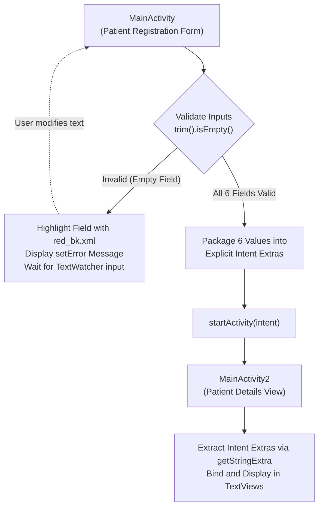

# Hospital (Android Demo)

An educational Android application demonstrating client-side form validation, dynamic UI error feedback, and explicit `Intent`-based data transfer between Activities using **Java** and the **Android SDK**.

> [!NOTE]
> **Academic Demonstration Project**: Despite the repository name, this project is **not** an enterprise Hospital Management System (HMS), clinical record system, or healthcare backend. It is an introductory educational demonstration ("Hospital Demo") designed to illustrate core Android UI and navigation concepts. It contains no persistent database, authentication, or network services.

---

## Overview

The application demonstrates a classic two-screen Android workflow:
1. **Patient Registration Form (`MainActivity`):** An input interface where a user enters patient details. The Activity performs sequential input validation, highlights invalid fields dynamically, and packages the data into an Android `Intent`.
2. **Patient Details Display (`MainActivity2`):** A secondary Activity that extracts the submitted data from the `Intent` extras and displays the values in formatted read-only text fields.

---

## Features

- **Six-Field Input Form:** Collects core patient details:
  - **Patient ID** (`id`) — Numeric input
  - **Patient Name** (`name`) — Text input
  - **Patient Surname** (`surname`) — Text input
  - **Patient Contact Number** (`number`) — Phone/numeric input
  - **Patient Email** (`email`) — Email input
  - **Patient Department** (`department`) — Text input
- **Empty-Field Validation:** Validates that each field is non-empty (`trim().isEmpty()`) in sequential order before allowing form submission.
- **Visual Error Feedback:** Dynamically updates the field border to a red outline (`red_bk.xml`) and displays a native Android error tooltip (`setError`) on the first offending field.
- **Dynamic Background Reset via `TextWatcher`:** Attaches real-time `TextWatcher` listeners to each input field, automatically reverting the border from error state back to standard styling (`edit_bk.xml`) as soon as the user resumes typing.
- **Explicit `Intent` Data Transfer:** Packages all six verified values into an explicit Android `Intent` using `putExtra(key, value)`.
- **Detail View Rendering:** `MainActivity2` retrieves the bundle extras via `getIntent().getStringExtra(...)` and populates corresponding `TextView` controls on screen.

---

## Architecture & Data Flow

The application follows a standard Android Activity-to-Activity data flow via explicit Intents. All data is handled **in-memory** and remains transient within the Android Activity lifecycle.



### Persistence Notice
- **No Database:** The application does not include SQLite, Room, or any local relational database.
- **No Local Storage:** No data is written to `SharedPreferences`, internal cache, or external storage files.
- **No Network Backend:** No REST API calls, Firebase services, or remote network endpoints are utilized.
- **Lifecycle Bound:** Once the application process finishes or the user exits the app, all entered data is cleared.

---

## Technology Stack

| Layer | Component | Specification |
| :--- | :--- | :--- |
| **Language** | Java | Java 8 (`JavaVersion.VERSION_1_8`) |
| **Platform** | Android SDK | Compile SDK: `32` (Android 12L)<br>Target SDK: `32`<br>Minimum SDK: `21` (Android 5.0 Lollipop) |
| **Build System** | Gradle | Android Gradle Plugin `7.2.1`<br>Gradle Wrapper `7.3.3` |
| **UI Components** | AndroidX & Material | `androidx.appcompat:appcompat:1.5.1`<br>`com.google.android.material:material:1.6.1`<br>`androidx.constraintlayout:constraintlayout:2.1.4` |
| **Testing** | AndroidX Test & JUnit | `junit:junit:4.13.2`<br>`androidx.test.ext:junit:1.1.3`<br>`androidx.test.espresso:espresso-core:3.4.0` |

---

## Setup & Execution

### Prerequisites
- [Android Studio](https://developer.android.com/studio) (Chipmunk 2021.2.1, Dolphin, Electric Eel, or newer recommended).
- **JDK:** A compatible Java Development Kit (JDK 11 is standard and bundled with modern Android Studio installations).
- **Android SDK:** Android SDK Platform `32` (installed via Android Studio SDK Manager).
- **Target Device:** An Android Virtual Device (AVD) running API Level 21+ or a physical Android device with USB debugging enabled.

### Step-by-Step Instructions

1. **Clone the Repository:**
   ```bash
   git clone https://github.com/contact2hitech/Hospital.git
   ```

2. **Open in Android Studio:**
   - Launch Android Studio.
   - Select **File** > **Open...** and browse to the cloned `Hospital` root directory.
   - Click **OK** to open the project.

3. **Gradle Sync:**
   - Android Studio will automatically recognize the Gradle wrapper (`gradlew`) and begin syncing dependencies.
   - Allow the sync to complete and build the project index.

4. **Run the Application:**
   - Select the `app` run configuration from the top toolbar.
   - Choose your emulator or connected physical device from the device dropdown.
   - Click **Run** (`Shift + F10`) to compile, install, and launch the application.

---

## Limitations

- **Empty-Check Validation Only:** Field validation only verifies that strings are not empty (`trim().isEmpty()`). It does not validate:
  - Email syntax or domain format (e.g., regex pattern matching).
  - Phone number length, international codes, or digits-only format.
  - Patient ID uniqueness or numeric range constraints.
- **No Data Persistence:** Form submissions are not saved; navigating back and resubmitting overwrites previous entries, and closing the app destroys all data.
- **Single-Record Flow:** Only one record can be handled at a time during the transition between the two Activities.
- **Healthcare & Regulatory Disclaimer:** This project is strictly an introductory classroom demonstration. It is not compliant with healthcare privacy regulations (e.g., HIPAA, GDPR) and must not be used in clinical, hospital, or production environments.

---

## Learning & Extension Opportunities

For students and developers exploring Android fundamentals, this codebase can be extended with several practical exercises:
1. **Local Database Integration:** Implement the [Android Room Persistence Library](https://developer.android.com/training/data-storage/room) to store patient registration records locally in an SQLite database.
2. **Regex Input Validation:** Enhance `MainActivity.java` with `android.util.Patterns.EMAIL_ADDRESS` for strict email validation and input filters for phone numbers.
3. **RecyclerView Patient Directory:** Add a third Activity featuring a `RecyclerView` that lists all registered patients with search and filtering capabilities.
4. **DatePicker Dialogs:** Replace the manual text inputs for birth dates or registration dates with Android's native `DatePickerDialog`.
5. **Modern Material Design:** Refactor form fields to use Material 3 `TextInputLayout` and `TextInputEditText` for animated floating hint labels and built-in error states.

---

## Repository Structure

```
Hospital/
├── app/
│   ├── src/
│   │   ├── main/
│   │   │   ├── java/com/example/hospital/
│   │   │   │   ├── MainActivity.java      # Form entry, validation logic, and Intent creation
│   │   │   │   └── MainActivity2.java     # Intent extras receiver and detail view display
│   │   │   ├── res/
│   │   │   │   ├── drawable/              # Custom background shapes and border styles
│   │   │   │   │   ├── button_bk.xml      # Submit button background drawable
│   │   │   │   │   ├── edit_bk.xml        # Default input field border
│   │   │   │   │   ├── main_bk.xml        # Card layout background
│   │   │   │   │   ├── red_bk.xml         # Validation error border drawable
│   │   │   │   │   └── HITECH_LOGO nobg-preview.png # Organization logo asset
│   │   │   │   ├── layout/
│   │   │   │   │   ├── activity_main.xml  # Registration form UI layout
│   │   │   │   │   └── activity_main2.xml # Patient details view UI layout
│   │   │   │   ├── values/                # Application colors, strings, and themes
│   │   │   │   └── AndroidManifest.xml    # Android application and activity declarations
│   │   ├── androidTest/                   # Instrumented Android test stubs
│   │   └── test/                          # Local JVM unit test stubs
│   ├── build.gradle                       # Module-level build script (dependencies, SDK versions)
│   └── proguard-rules.pro
├── gradle/wrapper/                        # Gradle wrapper distribution files (v7.3.3)
├── build.gradle                           # Project-level build script
├── gradle.properties                      # Gradle JVM and execution settings
├── gradlew / gradlew.bat                  # Gradle wrapper execution scripts
├── settings.gradle                        # Project module inclusion
└── README.md                              # Project documentation
```

---

## Author & Project Info

- **Author:** [HITESH PATEL (contact2hitech)](https://github.com/contact2hitech)
- **GitHub Repository:** [https://github.com/contact2hitech/Hospital](https://github.com/contact2hitech/Hospital)

<p align="center">
  
</p>
